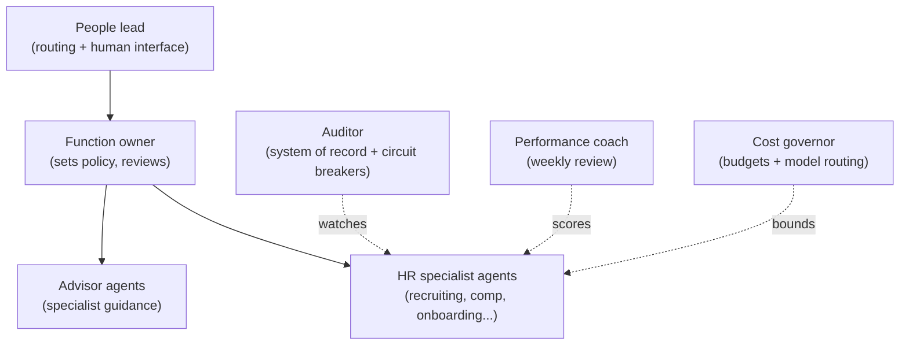

<!--
  This is your GitHub PROFILE README.
  It belongs in a repo named exactly:  skrodzkai/skrodzkai
  GitHub renders it at the top of github.com/skrodzkai automatically.
  Everything here is generic + safe to publish. Edit freely before pushing.
-->

<h1 align="center">Joe Skrodzki</h1>

  <b>I build the operating layer for agent-run People functions —
  with humans owning judgment, policy, and risk.</b>

  AI agents are about to run the HR back office — sourcing, comp, onboarding, performance,
  compliance. The hard part isn't the agents; it's governing a whole fleet of them safely
  and auditably at company scale.

  That's what I build. It's called <b><a href="https://github.com/skrodzkai/agentic-peopleos">Agentic PeopleOS</a></b>.

---

### Agentic PeopleOS

> The agent-run operating system for the People function.

An HR back office is mostly judgment applied to repeatable process — and that's exactly the
work a well-governed agent fleet can do. Agentic PeopleOS is the layer that makes it
trustworthy: every agent has a defined role, a budget, an audit trail, a performance review,
and hard limits — and a human owns every consequential decision.

---

### The People function, run by agents

| HR function | What the agent does | What the human owns |
|---|---|---|
| Recruiting & sourcing | finds, ranks, and reaches candidates | who advances |
| Screening & scheduling | screens, schedules, keeps the pipeline moving | the bar |
| Onboarding | runs the checklist, provisioning, day-one plan | the exceptions |
| Comp & benefits | benchmarks, models scenarios, flags outliers | offers & spend |
| Performance | drafts reviews, surfaces calibration gaps | ratings & promotions |
| Policy & employee Q&A | answers from policy, escalates the edge cases | the policy itself |
| Compliance & audit | watches every action, keeps the record | the risk posture |
| People analytics & reporting | compiles operating reports, flags risks, ties metrics to action | the decision, and what's published |

All of it on one operating system: every agent **onboarded, budgeted, audited, reviewed,
and human-gated** — and the fleet **improves itself** through controlled experiments a human
approves before anything ships.

---

### The same system, running today

The architecture isn't theoretical. The same operating system runs my autonomous trading
floor — 30+ agents that research, price, act, and reconcile on their own, 24/7, under
real-world market conditions, with risk controls, circuit breakers, a complete audit trail,
and a weekly self-improvement loop, all within limits I set. A back-office HR function is the
same problem in a calmer domain.

---

### How the fleet is organized

Every agent is onboarded the same way, runs on a budget, leaves an audit trail, and answers
to a human on anything that carries real consequence.

---

### What I work with

`Python` · LLM orchestration · multi-agent systems · agent governance & evals ·
model routing & cost optimization · human-in-the-loop design · HR / Total Rewards

---

### Notes
Always glad to compare notes with people building agentic HR, AI for people operations, or the governance layer that makes autonomous
agents safe inside a real company.

<!-- Add a public contact link here only if you want one. -->
<!-- LinkedIn: add a URL here if you want GitHub <-> LinkedIn cross-linking. -->
